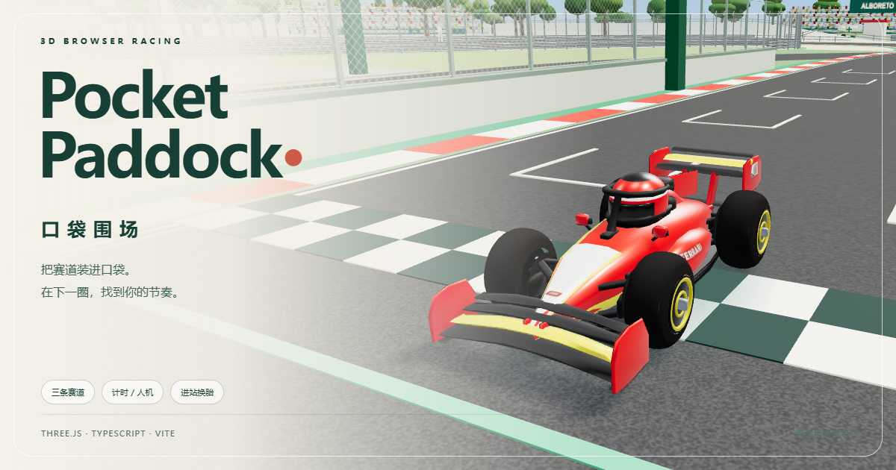

# Pocket Paddock · 口袋围场

[English](#english) · [简体中文](#简体中文)

## English

**0.15.0 · Playable Monaco and three-circuit racing.** Pocket Paddock is a chibi-style formula racing game built with Three.js, TypeScript, and Vite. Drive at Monza, Spa-Francorchamps, and Monaco in solo time trials or races against five AI rivals. Choose from 11 teams and 22 drivers, race in sunshine or rain, and play in English or Chinese with a keyboard or a standard-mapped gamepad.

[Getting started](#getting-started) · [Changelog](CHANGELOG.md) · [Project submission and images](docs/SUBMISSION.md) · [Play online](https://oxw9ji.gicp.fun/)



AI tools assisted development, and playtesting feedback guided changes to gameplay, models, interface, and performance. Car, helmet, and audio assets ship with the project. Install development dependencies with `npm ci`. All models, audio, and fonts used at runtime are available locally. When you play online, your browser renders the 3D scene on your device. Frame rate depends on the GPU, drivers, hardware acceleration, resolution, and quality settings. Hosting mainly affects access and loading times.

### Race Control Preview

Run `npm ci` and then `node scripts/build-race-control-preview.mjs`. Open `outputs/Pocket-Paddock-Race-Control-Preview.html` in Chrome or Edge. This self-contained page includes the garage and the playable game with no runtime network requests.

Choose your first circuit to fly from Danzhou, Hainan, China. After the circuit trace, five start lights turn on in sequence and the garage door rises. You can select a team, driver, race mode and starting tires, then carry those settings into the race. On a standard-mapped controller, use the D-pad to navigate and change selections, and A / × to confirm. During the race, use the left stick to steer, RT / R2 to accelerate, and LT / L2 to brake.

### Monaco Racing · 0.15.0

The 19-turn street circuit supports time trials and AI races with the full roster, weather modes, languages, and control options. Monaco has separate dry and wet lap records alongside the four Monza and Spa leaderboards.

The driving scene scales the review model by 3.2 so the existing cars fit the streets. The relative placement of the buildings, harbor, 36 boats, 110 trees, nine grandstands, garages, and strategy booths is preserved. Monaco uses a circuit-specific steering rack to navigate the tightest hairpin at low speed. Available steering angle decreases at higher speeds, and tire grip still limits cornering. AI drivers merge into single file before narrow bends and can run side by side on wide straights.

Collision boundaries follow the geometry of angled walls and buildings, with openings for garage entrances and the tunnel. Enter the pit lane manually to trigger the 120 km/h limiter, assisted parking, and a randomized 2–4 second tire change with a 16-person crew. Manual control returns immediately after the tire change, with the speed limit still active in the pit lane. The circuit is a stylized miniature. Speeds, lap times, and buildings are adapted for arcade gameplay.

Monaco has one DRS zone based on the 2025 circuit map. The game closes DRS before Turn 1 to leave room for braking. [FIA 2025 Monaco circuit map](https://www.fia.com/system/files/decision-document/2025_monaco_grand_prix_-_race_directors_event_notes_-_circuit_map_pit_lane_map_ers_battery_containment_area_red_zones.pdf)

### Spa Gradients and Pit Lane · 0.14

The road mesh, continuous elevation, gradients, and vehicle ground contact use the same elevation profile. This removes pitch jumps caused by switching between nearby elevation samples. The original layout, the Eau Rouge and Raidillon climb, and the elevation changes around the lap are preserved. The fix applies to the road geometry and the driving model.

The rebuilt pit lane has a 12-unit fast lane, a 2-unit blue-green divider, and a gray working area. The meshes are cut to meet the main circuit without overlapping, and the rounded entry has a continuous shape. Following the FIA circuit map, the pit exit goes around La Source before merging. All 11 garages have three walls, door frames, interior lights, and tools, with a strategy room and computers for every team. Static crew stand inside the garages to leave room for the 16-person pit stop and the parked car. A longer approach lets the car gradually move sideways into its assigned bay. Monza retains its existing driving route.

Monaco also has a separate circuit preview. V1.4 completes the side walls of all eight garages and adds 16 telemetry displays, keyboards, seats, and crew figures with torsos and helmets. It adds a close-up camera for the strategy desk. The architecture and workstations are stylized miniature models.

### Assisted Pit Stops

Choose the next set of tires (S/M/H/W) in the garage menu or on the driving HUD, then drive into the pit entry. At Monza, the assist activates across the full entry road beyond the kerb and the approach straight before the garages. Simply drive into that area. The main racing surface, white lines, and red-and-white kerbs lie outside the trigger. The game limits the car to **120 km/h**, drives to the assigned team garage, and changes tires with a 16-person crew. The former PIT 70 pavement marking has been removed. A valid entry draws one stop time between 2 and 4 seconds. Pausing freezes that time and preserves the draw. Steering, throttle, and braking return to the player as soon as the tire change ends. The 120 km/h limiter applies throughout the pit road and work area and releases when you exit.

Monza and Spa have fixed garages for all 11 teams. Monaco has eight reviewed garages. Selecting Audi, Cadillac, or Racing Bulls assigns the team to the eighth bay and updates the garage signage, the strategy booth on the right, and the crew colors. The race clock and AI keep running during pit stops. A legal pit passage can count toward a lap and is exempt from track-limit penalties. Pressing R aborts the stop and returns the car to the circuit. Tires are fitted only when service finishes. Restarting clears the assist and the random stop time. Pause and reset remain available while the assist controls driving.

Choose soft, medium, hard, or wet starting tires in the paddock. In a race, you can make multiple optional stops and choose the next set each time. Tire life and the fitted compound update after service. Resetting the car to the track preserves wear. The square letter markings have been removed from the sidewalls. The 120 km/h limit is an arcade setting requested by the player.

`src/pit-lane-controller.ts` handles entry detection, assisted driving, the speed limiter, and the stop-time draw. `src/pit-service-view.ts` plays the approved animation at the real in-game bay, then releases the crew and restores the car's wheel meshes after completion or cancellation. `src/pit-stop-audio.ts` retimes the sound effects to the drawn duration while preserving the recording pitch at normal playback speed. The standalone model preview remains available.

Start Vite and run `node scripts/check-pit-game.mjs` to verify the pit flow. Other checks include `npm test` and `node scripts/check-offline.mjs`. The browser report distinguishes keyboard driving from the grid and test setups that position the car just before the pit entry.

### Pit Stop Animation Preview · V5

The standalone model and motion preview uses a fixed 2.6-second stop. In the game, each stop takes a randomly selected 2–4 seconds. [Open the standalone pit stop preview](https://pocket-paddock-monza.leowang8431.chatgpt.site/pit-stop.html?v=5)

The car is parked with its sidepod facing the garage. The scene retains 16 crew members in distinct roles, oval torsos and small S/M/H/W tire labels. V3 made the torsos wider and deeper. Tire carriers now work close to the wheels, wheel-gun operators stay near the actual grips and step aside with their tools during the handover, and jack operators work close to the jack handles. The simplified crew models retain their limbless silhouettes.

In V5, all four tires are changed in parallel in 2.6 seconds from standstill to release. For review, the sequence takes 5.2 seconds at 0.5× and 10.4 seconds at 0.25×. The updated timing allows more time for wheel-gun contact. Crossfades join recorded mechanical impact clips into a continuous sound while the tools are in use. Normal playback preserves the recording pitch.

An independent cantilever stand holds the double-sided red and green release light above the front of the car. A side post supports the stand, which stays fixed throughout the animation. The light turns green after the car is back on the ground, the wheels are tightened and the crew has cleared the car. The signal lives in `src/pit-stop-release-signal.ts` and is independent of the jack and crew models.

Recorded wheel-gun sounds, metal movement Foley and rubber contact Foley are synchronized with the staggered actions at all four wheels. Playback has mute and volume controls. Audio goes silent during pauses and timeline scrubbing. It resumes from the matching point in the animation when playback continues, restarts, loops or changes speed. The first Play click enables browser audio, and the default 1× speed preserves the recording pitch. The mix is limited to those effects, with wind noise, crowd sounds and electronic cues left out. The preview's Sound Sources section and `THIRD_PARTY_NOTICES.txt` document the sources and licences. The credits describe recorded mechanical effects and Foley, with F1 team provenance unspecified.

The 2.6-second stop supports 11 teams, four replacement tire compounds, five camera angles, 0.25×, 0.5× and 1× playback, looping and free timeline scrubbing. The front jack moves sideways to clear the driving line. Separate crew members handle the used tires and their replacements. The game's original wheels, liveries and geometry assets remain separate.

Run `npm run dev` and open `/pit-stop.html` for development. `npm run build` builds the game and the standalone `dist/pit-stop.html` preview. The race displays a single pit crew during the player's tire change. `npm run build:pit-preview` generates `outputs/Pocket-Paddock-Pit-Stop-Preview-V5.html`, which opens directly in Chrome or Edge for offline review.

`PitStopAnimation.setTime(seconds)` determines the pose, so scrubbing backwards produces consistent poses without accumulating drift. The animation is in `src/pit-stop-animation.ts`, the studio scene in `src/pit-stop-stage.ts`, the interface in `src/pit-stop-preview.ts`, real-time timing and pose mapping in `src/pit-stop-timing.ts`, and audio in `src/pit-stop-audio.ts`. `node scripts/check-pit-stop-audio.mjs` verifies actual Web Audio output, pausing, playback speed changes, muting and animation fallback when audio is unavailable. `npm run test:pit-preview` runs the checks in Chrome. Optional video recording requires Playwright's FFmpeg setup for development.

### Getting Started

Use Node.js 20.19+ or 22.12+ and desktop Chrome or Edge with hardware acceleration enabled.

```sh
npm ci
npm run dev
```

Open the address shown in the terminal. To test, build and preview the production version, run the following commands.

```sh
npm test
npm run build
npm run preview
```

`npm run build:offline` uses the version from `package.json` to generate `outputs/Pocket-Paddock-Offline-0.15.0.html`. This HTML bundles the scripts, styles, models and pit stop audio, and runs directly in Chrome or Edge without Node.js, a server, a network connection or a VPN. Extract it first and open it directly in your browser outside WeChat's file preview. Frame rates vary by device. Start with the Auto graphics setting.

For `file://` sessions, saved times and settings depend on the browser, the file location, browser data clearing and storage permissions. The offline build and the website use separate records. The game remains playable when storage is unavailable.

Direct access from mainland China can be unreliable without a VPN. Public hosting migration is on hold at the user's request. `deployment/` contains preparation files for deployment. [Play Pocket Paddock online](https://pocket-paddock-monza.leowang8431.chatgpt.site/)

### In This Release

- Choose **Monza / Spa / Monaco** from the menu. All teams, weather settings, languages, camera options and race modes are available across the three circuits. Circuit changes are available in the paddock. The loading screen names the destination circuit and stays visible until the scene and car have drawn their first frame. The fallback car is reserved for model-loading errors.
- Monza retains its original layout, with Roggia and Lesmo 2 narrowed by 5% in selected sections. The grandstands expand from 7 to **21, with 6,184 spectators**. The original seven keep their positions and orientations. The fourteen additions were checked for clearance from the circuit, pit area and roofs, and conflicting trees were relocated.
- Spa is a complete standalone circuit. The 7,004-metre reference layout is scaled to **4,202.4 game units**. Eau Rouge and Raidillon feature a drivable climb, and elevation varies elsewhere too. Gradients affect acceleration. Cars, AI rivals, cameras, kerbs and wet-weather effects follow the terrain.
- Spa's signature grandstand takes its cues from official imagery, with 40 rows, 4,600 seating positions, a large grey canopy, a glazed hospitality area underneath and external switchback stairs. The circuit has **21 grandstands, 9,766 spectators and 1,800 trees of mixed species**. The other twenty stands are game facilities with counts and locations chosen for the project.
- Monza and Spa retain fully equipped strategy booths for all 11 teams, 68 simplified staff figures, pit area details and a **RIOLEX** clock. Spa has its own GP building design. The twin towers and Fans Club are specific to Monza. Monaco retains eight reviewed garages and updates the garage signage and assignment to match the selected team.
- Separate records for **three circuits × dry and wet weather** give six leaderboards. Each circuit and weather combination saves independently. Race mode keeps its results separate from the time-trial boards.
- The engine continues to use the recorded CC0 mechanical cycle waveforms from 0.11, with the random noise and air layers removed. Upshift fuel cuts, downshift throttle blips and launch load share the eight-speed engine RPM state.

### Controls

| Action | Keyboard | Xbox / PlayStation standard mapping |
| --- | --- | --- |
| Throttle / brake and reverse | W / ↑, S / ↓ | RT / R2, LT / L2 |
| Steering | A D / ← → | Left stick |
| Return to track | R | Y / △ |
| DRS | F | X / □ |
| Close / standard / far camera | C | R3 |
| Pause / resume | Esc | Menu / Options |
| Start / race again | Enter or on-screen button | A / × |
| Return to the paddock | On-screen button | B / ○ |

Press a button after connecting the controller so the browser can recognize it. The game supports the `standard` mapping with analogue sticks and triggers. Disconnecting a controller pauses the game. After reconnecting, release the action buttons before pressing them again. Controller verification to date uses the simulated Gamepad API. Physical testing by controller model is pending.

Brake in a straight line, ease off as you turn in, and accelerate as you unwind the steering. Wet conditions reduce grip and extend braking distances. Grass and gravel slow the car. The central tire display shows the fitted compound, remaining life, and average temperature.

### Racing and DRS

Time trial includes a five-light countdown, speed, gear, and RPM readouts, current and best lap times, waypoints, and local records. AI races field **six cars** and run for **8 laps at Monza and 5 each at Spa and Monaco**. Each start or restart shuffles the six grid positions. Consecutive starts in the same session give the player different slots.

A forward finish-line crossing counts once the car has covered enough of the circuit. Waypoints are optional navigation aids. The initial grid crossing and short movements back and forth over the line earn no lap. A sustained track-limit excursion adds **3 seconds** to the lap and race time. Repeated brief cuts can also incur a penalty. A reset or a track-limit penalty makes the lap ineligible for a personal best. The live leaderboard shows the measured gap to the preceding position, such as P3 to P2. Finish order uses race times with penalties applied.

Grip, temperature, and wear are tracked per tire. Soft tires trade wear for grip on dry roads, hard tires last longer, and wet tires perform better in the rain. Wear reduces grip and attainable speed. The AI also wears its tires and weighs tire condition, laps remaining, and estimated pit loss before selecting a replacement compound. When an AI car pits, it drives to its team bay, stops for 2–4 seconds, and merges back under the pit-road limiter. The leaderboard marks pit entry, service, and exit.

AI rivals brake for corner curvature, adjust speed to traffic and available grip, and check the closing speed and space before overtaking. A common contact solver applies normal and friction impulses to cars and walls. Rear-end contact can transfer forward momentum, and offset impacts can induce yaw and sideways movement. The player and AI use the same optimized GLB at about **27,540 triangles per car**. Shared geometry and instanced drawing reduce the cost of rendering rivals.

Classic DRS uses the **FIA 2025** maps as its reference. In dry weather, the player opens DRS manually on a designated straight once the car is moving forward, above the minimum speed, and clear of the pit lane. Braking, leaving the road, a collision, reversing, or leaving the zone closes DRS automatically. The player reopens it in each zone. AI can use DRS while accelerating in the designated zones on dry roads. Availability is independent of the one-second gap rule for the car ahead.

| Circuit | Real detection / activation reference | In-game mapping |
| --- | --- | --- |
| Monza 1 | 95 m before T7 / 170 m after T7 | From the Lesmo 2 exit to before Ascari |
| Monza 2 | 20 m after T11 / 12 m after the finish line | From the main straight to before the first chicane |
| Spa 1 | 240 m before T2 / 305 m after T4 | From Kemmel to before Les Combes |
| Spa 2 | 160 m before T18 / 30 m after T19 | From the GP main straight to before La Source |
| Monaco | 80 m after T16 / 18 m after T19 | Across the start and finish line on the main straight, closing before the T1 braking zone |

Real-world distances are scaled by the length ratio for each circuit. Corner exits use in-game centerline anchors, and DRS closes at the game's braking zones. Spa's T19 exit uses an artistic placement about 55 metres beyond the Bus Stop anchor. Its coordinates are approximate.

### Real-world references and artistic adaptation

#### Monza

The pit buildings and grandstands occupy opposite sides of the main straight, and the pit lane and paddock facilities follow the broad arrangement shown in the references. The freestanding TOWER buildings and the curved Fans Club retain their distinct forms. [Official grandstand map](https://www.monzanet.it/wp-content/uploads/2023/09/MAPPA_CIRCUITO_2023_tribune.pdf), [official 2026 GP Hospitality brochure](https://www.monzanet.it/wp-content/uploads/2025/11/Brochure_Hospitality_GPf12026.pdf), [FIA 2025 Italian Grand Prix circuit map](https://www.fia.com/system/files/decision-document/2025_italian_grand_prix_-_event_notes_-_circuit_map_pit_lane_emergency_exit_map_quarantine_zone_and_red_zones.pdf).

Building and grandstand sizes, garage counts, distances, decorative details, and additional stands were adapted to the shorter circuit and rearranged to fit the scene. Monza House and Ultimate Hospitality draw on the official hospitality brochure above. Cascina Costa Alta and the Serraglio gatehouse serve as recognizable park landmarks, with approximate dimensions, placement, and in-game sightlines. [Official Reggia di Monza architecture guide](https://reggiadimonza.it/architetture/).

Broad-canopied and columnar trees help capture the character of the park. The cranes and ambulances behind the barriers and the tire walls in gravel areas are static scenery, with artistic choices for vehicle types, quantities, and parking locations. [Official park nature guide](https://reggiadimonza.it/natura/).

#### Spa-Francorchamps

The circuit plan comes from Tomislav Bacinger’s `f1-circuits` project, with its MIT license documented in `THIRD_PARTY_NOTICES.txt`. Elevations are interpolated between published reference points. [f1-circuits GeoJSON](https://github.com/bacinger/f1-circuits/blob/master/circuits/be-1925.geojson), [official circuit venue guide](https://www.spa-francorchamps.be/sites/default/files/pdf/en/SF_access-organiser.pdf).

The Raidillon grandstand draws on the circuit’s 2022 infrastructure announcement and venue rental gallery. The DRS zones follow the FIA’s 2025 Belgian Grand Prix circuit map. [Official infrastructure announcement](https://www.spa-francorchamps.be/en/news/262_inauguration-of-the-new-infrastructure-of-the-circuit-of-spa-francorchamps), [official venue rental gallery](https://www.spa-francorchamps.be/en/evenement-locationdesalles), [FIA circuit map](https://www.fia.com/system/files/decision-document/2025_belgian_grand_prix_-_event_notes_-_circuit_map_pit_lane_emergency_exits_quarantine_zone_and_red_zones.pdf).

The road and elevation profiles share one model, with simplified terrain, barriers, pit lanes, and buildings. La Source and the Bus Stop were rounded locally to accommodate the toy cars’ steering radius while retaining the recognizable hairpin and double bend and the full circuit’s length proportions. The pit entry branches to the driver’s right between Turns 18 and 19 at the Bus Stop. The main service area is level. The exit curves smoothly around the inside of La Source and rejoins the main track after the corner. A continuous periodic curve smooths elevation across the lap, and the road geometry and wheel contact use the same height data.

**The buildings are miniature interpretations based on photographs.** Grandstand outlines, seating capacity, and hospitality levels draw on those references. Dimensions, the placement of other stands, and the forest layout were estimated for the miniature scene using the available material, which lacked architectural CAD and on-site measurements.

#### Cars, pit walls, and audio

The cars and helmets come from user-supplied GLB, OBJ, MTL, and CSV files. Meshes and materials were consolidated and optimized for runtime use. Driver years, rosters, and liveries follow the supplied asset data. Unverified patterns are treated as interpretations, and the supplied assets came without separate license documentation. Any additional permissions come from the original rights holders.

Each team has a pit-wall room with four engineers, eight screens, and its own team-color markings. The twelve garage bays also have monitors, keyboards, tools, tire carts, booms, and hoses. The 68 strategy and pit crew figures use torsos, team-colored helmets, and dark visors. Engineers also wear headsets. The screen graphics display decorative data. [McLaren’s official pit-wall overview](https://www.mclaren.com/racing/formula-1/2026/who-sits-on-mclarens-pit-wall/), [F1’s guide to the pit wall](https://www.formula1.com/en/latest/article/the-insiders-guide-to-the-pit-wall.CFwHwjTcLNO5Gf4B3Dy4o).

The project decoded and analyzed the 106.25-second audio track from Lando Norris’s 2024 Monza pole lap to study mechanical harmonics and gear changes. The official video and onboard audio were used only for analysis. [Official F1 onboard lap](https://www.formula1.com/en/video/onboard-lando-norris-2024-pirelli-pole-position-award-lap-at-the-italian-grand-prix.1808919989852209304).

The distributable engine sound uses two custom Web Audio waveforms derived by averaging phase-aligned cycles from a CC0 recording. The source car and year are unverified, and the synthesis captures a general engine character. `scripts/prepare-engine-cycles.py` reproduces the extraction. Python and the original recording are only needed for that extraction, and the regular build uses the prepared waveforms. Sound is on by default and starts on the first Start interaction. The Sound button controls the game audio and saves your preference for the next visit. [lmnmrn’s motor.wav / F1 Engine Ignition](https://freesound.org/people/lmnmrn/sounds/197219/).

### Code map

`src/monza-historic-oval.ts` generates Monza’s historic oval scenery, including the north and south banked concrete turns, the old eastern straight, support ribs, concrete joints, and period barriers. The modern GP circuit passes beneath the north turn. The real 1955 high-speed oval measured 4,250 metres, with a turn radius of about 320 metres and a maximum grade of 80% at the outer edge. The game preserves progressive banking in the cross-section, while the footprint is compressed to fit the shorter map and avoid the grandstands, buildings, and pit facilities. The shared western straight uses the existing route to leave the garages clear. The historic oval is a stylized scenic feature outside the drivable routes. Trees and service vehicles are placed clear of its footprint, and the modern GP centerline and driving elevations use the original game geometry. [Official Monza banking overview](https://www.monzanet.it/sopraelevata-monza/), [official circuit history](https://www.monzanet.it/autodromo-di-monza-storia/), [official Serraglio sector description](https://www.monzanet.it/tracciato-pista-monza/).

The overpass has a full-width, level deck. Each approach is 82 units long, with a constant-grade section and a 12-unit transition. The banking eases to level before the bridge, and the road stays flat across its width on the descent. The roughly 65-unit northern maintenance link is 10 units wide and joins the GP circuit through a wide opening at a shallow 30-degree angle. The first 45% of its approach stays level. The south turn and its roughly 97-unit link follow one continuous convex curve from `src/monza-historic-south-plan.ts` in place of the former sequence of S-bends and separate arc segments. The southern link is also 10 units wide, with its banking and base elevation easing to the main track’s level surface over the first half. Both joins clip the actual triangles where they intersect GP asphalt, forming level, full-width openings. The gravel and green runoff meshes are subdivided locally and trimmed along the paved edges, while the GP road uses its original vertices, elevations, and driving physics. The kerbs and fences have openings at the joins, with maintenance barriers across the closed links. Separate normals for the road surface and edge caps, along with wear strips fitted to the actual surface triangles, keep lighting consistent and prevent surfaces from intersecting. The grades and junction proportions are adapted to the miniature scene, and the oval serves as scenery only.

Five broadcast camera positions along the main straight feature long lenses, tripods, operators, and platforms at different heights. They face the circuit and leave the pedestrian path clear. The footprints in `src/monza-marshal-layout.ts` keep the red-roof marshal post and its signs clear of the historic oval, modern barriers, grandstands, and flagpole equipment. The Rettifilo DRS activation sign is on the driver’s left at the original activation distance. Mipmapped glTF alpha blending preserves the catch-fence mesh at medium and long distances, where a high alpha cutoff can filter the wires down to isolated dots.

The rubber tire barriers have thick sidewalls, rounded shoulders, and open centers. All 480 tires are rendered in a single instanced draw call. Both TOWER buildings and the Fans Club have continuous curtain walls along their straight sides and finished roof and floor-slab joints, with visible stair doorways and garage openings. The Monza pit apron and fast lane use adjoining paved surfaces so the player can drive out manually after service. The 120 km/h limit applies to the separate pit road and working apron beyond the kerb. At the entry and exit overlaps, the full GP road and red-and-white kerb take priority, and the limiter releases on the first frame back on the main track.

| Module | Purpose |
| --- | --- |
| `src/main.ts` | Scene, fixed-step game loop, game state, and UI integration |
| `src/track.ts`, `spa-track.ts`, `monaco-drive-track.ts` | Road queries, surfaces, checkpoints, geometry, and elevation |
| `src/scenery.ts`, `spa-scenery.ts`, `monaco-game-scenery.ts` | Buildings, woodland, grandstands, and instanced rendering across the three circuits |
| `src/pit-complex.ts` | Pit garages, pit-wall rooms, staff, and the RIOLEX clock |
| `src/pit-lane-controller.ts`, `pit-service-view.ts` | Assisted pit entry, randomized tire changes, tire markings, and service animation |
| `src/physics.ts`, `handling.ts`, `tire-physics.ts`, `race-contact.ts` | Driving controls, per-tire simulation, and contact impulses |
| `src/fleet-car.ts`, `team-catalog.ts` | GLB loading, liveries, helmets, and car details |
| `src/ai-race.ts`, `ai-rivals.ts`, `ai-pit-strategy.ts`, `ai-pit-route.ts` | Rival pace and traffic, pit decisions and routes, and shared car models |
| `src/race.ts`, `competition.ts`, `race-intervals.ts` | Finish-line lap counting, track-limit penalties, standings, gaps, and timing records |
| `src/camera.ts`, `road-pose.ts` | Showroom camera, three chase views, and vehicle pose on slopes |
| `src/powertrain.ts`, `audio.ts`, `engine-cycles.ts` | Eight-speed RPM, gear changes, and mechanical-only engine audio |
| `src/drs.ts`, `drs-markers.ts`, `drs-wing.ts` | DRS zones, signage, and movable rear wings |
| `src/ui.ts`, `i18n.ts`, `circuits.ts` | Car selection, circuits, bilingual UI, and storage keys |
| `src/weather.ts`, `quality.ts` | Sun and rain, render resolution budgets, and automatic quality |

### Verification and Next Steps

`npm test` covers the actual models, lap-counting safeguards, physics, AI, DRS, audio parameters, and separation of the six leaderboards. It also checks clearances around grandstands, buildings, and woodland, along with terrain heights. Monaco checks cover the shoreline footprint, yacht shapes at their placed orientations, separation of the pit-lane surfaces, and the 2025 DRS reference locations. The command output reports the current test count. Separate pit-stop preview checks cover the fixed release light, complete tire models, all 16 crew animations, the placement of tools close to the crew, and hose clearance. At Spa, digital controls drive the actual vehicle and race session through full laps. Geometry scripts also check the terrain, roads, pit lane, and facility clearances.

`test:competition` drives an eight-lap Monza race with keyboard events. `test:presentation` checks that the entire car is visible at three screen sizes. `test:audio` uses `OfflineAudioContext` to verify the recorded engine cycles, gear changes, and muting. `test:offline` checks launch from a local file. Browser scene diagnostics through `window.__PP` are available only in Vite's development mode.

Verification on other GPUs and browsers, with physical controllers, and through speakers requires separate testing. Future work includes improving performance across devices, refining AI difficulty, racing lines and pit strategy, and adding more detail to the scenery. Migration to public hosting accessible without a VPN comes after those improvements.

### Initial Monaco Map Preview

Run `npm run dev` and open `/monaco.html`. Rotate and zoom the model, choose from nine camera views, open the tunnel cutaway, or tour the circuit. For a playable session, choose Monaco in the game's circuit selector or click **Drive Monaco** at the top right of the review page.

`npm run build:monaco-preview` generates `dist/monaco.html` and the standalone `outputs/Pocket-Paddock-Monaco-Preview-V1.html`, which opens directly. The page also exports the full GLB model. This README describes the references and artistic adjustments. The standalone review page's version history is in the [changelog](CHANGELOG.md).

V1.1 places the full bases and roofs of all seven grandstands back on land, distributes 36 boats of varied sizes and headings at different densities, and increases the total to 110 palm, cypress, and layered pine trees. The DRS toggle shows the FIA's 2025 reference positions, with detection 80 m after T16 and activation 18 m after T19. Green roadside dashes are review guides in the visual-only preview. The main game supports driving physics and working DRS.

V1.2 replaces the former site of grandstand V, which sat away from the track, with a five-story harbor apartment building. Three compact grandstands, Q1 through Q3, occupy the land on the seaward side of T14–T17 and face their respective track sections. The other six grandstands occupy their original sites, with the city-side open grandstands N and O facing the nearest part of the start and finish straight. There are nine grandstands in all. Regression checks confirm that the apartment building's eaves and balconies fit within the former V footprint and that the new grandstands clear the water, roads, and docks.

V1.3 rebuilds the wider dedicated pit lane, continuous two-story block of eight garages, and stopping apron using the FIA pit-lane diagram. The dark blue-gray fast lane, blue-green strip, and working area meet edge to edge. The barriers and catch fencing have physical openings at the entry and exit. A dedicated pit-lane camera frames the facilities alongside the original Monaco circuit layout.

V1.4 completes the solid side walls of all eight garages and replaces the small computers with dual-screen telemetry workstations. Each workstation includes a keyboard, mouse, chair, and a crew figure with a team-colored torso and helmet. The eighth camera button, **Strategy Desk Close-Up**, looks into the first garage. The gray work area has a distinct boundary with the fast lane.

V1.5 places eight individual team strategy pods on the white island to the right of the fast lane, next to the main-track wall and opposite the garages. Each pod has four telemetry screens, keyboards and mice, two seats, and two torso-only crew figures with oval bodies and team-colored helmets. A narrow rear canopy keeps the screens visible. A new **Right-Side Strategy Pods** camera shows the island. The former workstation close-up is now called **Garage Interior**. Clearance checks cover the roof overhangs, foundations, and crew figures along the circuit, fast lane, wall, and catch fencing. Pod count and dimensions are scaled for the review model.

V1.6 mounts the starting lights on a single-post cantilever on the grandstand side. The post reaches the ground, the beam clears the pit building, and the lights face the drivers on the grid. The actual seats of grandstands E, P, and T face the nearest part of the main circuit. Spectators in these three stands have front-facing eye details.

The pit-building expansion increases each garage from 3.4 × 3 to 4.05 × 3.3 units, adding about 31% to the floor area. Computers and tools sit along the sides to provide central parking space. The fast lane is 6 units wide, and the working apron is 3.5 units wide. The layout has eight garages and eight individual team strategy pods on the right.

---

## 简体中文

**0.15.0 · 摩纳哥正式驾驶与三赛道比赛**。Three.js + TypeScript + Vite 制作的 Q 版方程式赛车游戏，提供蒙扎、斯帕和摩纳哥。可单人计时，也可与五辆 AI 赛车竞速。支持 11 支车队、22 位车手、晴雨两种天气、中英文界面、键盘及标准映射手柄。

[启动项目](#启动) · [版本更新日志](CHANGELOG.md) · [作业项目说明与图片](docs/SUBMISSION.md) · [在线试玩](https://oxw9ji.gicp.fun/)


本项目在 AI 工具辅助下持续迭代，通过试玩反馈完善玩法、模型、界面和性能。赛车、头盔及音频资源随项目提供，开发依赖通过 `npm ci` 安装。运行时不访问外部模型库、音频库或字体 CDN。线上 3D 渲染仍由访问者电脑完成，帧率取决于显卡、驱动、硬件加速、分辨率和画质；更换托管平台主要影响加载与访问，不会让云端替电脑渲染。

### 发车指挥台预览

先运行 `npm ci`，再运行 `node scripts/build-race-control-preview.mjs`。用 Chrome 或 Edge 打开 `outputs/Pocket-Paddock-Race-Control-Preview.html`。单文件包含可操作的车库和完整比赛，运行时无需联网。

首次选择赛道后从中国海南儋州起飞，完成描线后五盏发车灯依次点亮，车库门升起。可选择车队、车手、比赛模式和起步胎，进入比赛时保留设置。标准映射手柄用方向键导航和更改选项，A / × 确认。比赛中用左摇杆转向，RT / R2 加速，LT / L2 刹车。

### 摩纳哥正式比赛 · 0.15.0

这条拥有 19 个弯道的城市赛道支持计时挑战和人机竞速，可使用完整车手阵容、天气、语言和操作选项。摩纳哥晴雨最佳圈分别存储，与蒙扎、斯帕的四个榜单并列。

比赛场景将审核模型统一放大 3.2 倍，使既有赛车能放进街道，并保留建筑、海港、36 艘船、110 棵树、9 座看台、车库与策略舱的相对关系。摩纳哥使用专用转向参数，以低速通过最紧的发卡弯。车速升高时可用转角减小，过弯仍受抓地力约束。人机在窄弯前提前收回中心排队，宽直道可以并行。

护墙与建筑碰撞来自实际旋转墙段，P房入口与隧道行车空间保持开放。手动进入维修支路后采用120km/h上限、辅助停车和16人2–4秒随机换胎；换完立即手动驶出，维修区内限速继续生效。场景为微缩艺术化模型，赛道速度、圈速与建筑并非职业F1模拟或测绘复刻。

摩纳哥设有一处 DRS 区，游戏在 T1 前关闭 DRS，留出制动距离。[FIA 2025 摩纳哥赛道图](https://www.fia.com/system/files/decision-document/2025_monaco_grand_prix_-_race_directors_event_notes_-_circuit_map_pit_lane_map_ers_battery_containment_area_red_zones.pdf)

### 斯帕坡道与维修区 · 0.14

道路网格、连续高度、坡度与车辆接地使用同一份高程曲线，消除最近采样点切换造成的俯仰跳变；保留原平面路线、Eau Rouge / Raidillon 上坡与全圈高差。此修复作用于道路及驾驶数据，不通过镜头抖动滤镜遮盖起伏。

维修通道重建为12单位宽快速通道、2单位蓝绿分隔带与灰色工作区，三者与主赛道路面真实裁切，没有重复覆盖。入口圆角不再自交；按 FIA 赛道图让出站支路绕过 La Source 后合流。11间车库补齐三面墙、门框、内灯与工具，保留各车队完整策略室与电脑；静态工作人员退入车库，让出16人换胎动画和赛车停靠空间。赛车以较长的横移路径逐渐停到对应车位，蒙扎驾驶路线保持原设定。

摩纳哥同时保留独立地图审核页。V1.4补齐8间P房的侧墙，加入16块遥测屏、键盘、座椅及躯干和头盔工作人员；新增“策略台近景”机位。建筑形态与工位为微缩艺术化制作，并非测绘复刻。

### 游戏内自动进站

在围场或驾驶 HUD 选择“下一套”轮胎（S/M/H/W），手动驶入维修支路。蒙扎接管区覆盖路肩外的整段入口路面及进入车库前的缓行直道，包含道路两侧；正常行驶进入这一区域即由电脑接管，无需跨过某个窄门或对准路中一点。主赛道、白线和红白路肩排除在接管区外。电脑以 **120 km/h** 为速度上限开到对应车队 P 房前，由16人完成换胎。入口已删除原“PIT 70”地板标识。每次合法进入只随机抽取一次2–4秒停站时长，暂停不会重抽或消耗服务时间。换胎完成立即交还方向、油门和刹车，由玩家手动驶出；在维修区道路和工作带内仍保持120 km/h硬限速，驶出后解除。

蒙扎和斯帕的 11 支车队使用各自的固定车库。摩纳哥保留 8 间已审核车库，选择奥迪、凯迪拉克或红牛二队会分配至第 8 间，车库标识、右侧策略舱及工作人员队色同步更新。进站时比赛计时和 AI 继续运行。合法通过维修区可计入圈数，并豁免赛道边界罚时。停站中按 R 会中止服务并回到赛道，只有完成换胎才会装上新胎。重开比赛会清理自动驾驶和本次随机时间。键盘、触屏和手柄驾驶输入在接管期间暂停作用，仍可暂停或重置。

发车前可在围场选择软胎、中胎、硬胎或雨胎。玩家自行决定何时进站，一场比赛可多次换胎并分别选择下一套。服务完成后更新已装胎种与剩余胎况，回到赛道重置位置时保留磨损。轮胎侧面的字母方块已删除。120 km/h 是玩家指定的街机游戏设定。

`src/pit-lane-controller.ts`负责入口检测、自动路线、限速和单次随机时长；`src/pit-service-view.ts`在实际车位执行审核过的动画，完成或取消后释放维修人员并恢复原车轮；`src/pit-stop-audio.ts`按抽取时长重新编排音效，正常速度保留录音音高。原有独立模型审核页仍可使用。

验证入口：`node scripts/check-pit-game.mjs`（先启动Vite），另有`npm test`与`node scripts/check-offline.mjs`。浏览器报告明确区分从发车出发的真实键盘路线与入口前测试摆位。

### 换胎动画模型审核 · V5

[打开独立换胎预览](https://pocket-paddock-monza.leowang8431.chatgpt.site/pit-stop.html?v=5)。用于审核模型和动作，独立预览保留2.6秒基准，正式游戏采用每次2–4秒随机停站。

赛车侧箱朝向P房，保留16位分工人员、椭圆躯干和S/M/H/W小胎标。V3将躯干进一步加宽加厚，让轮胎搬运人员随轮近身操作，枪手靠近真实握把并在拆装交接时带枪退让，千斤顶操作员靠近实际握把。保留无腿脚手臂的精简造型。

V5以2.6秒完成从停稳到放行的四轮并行流程，0.5倍/0.25倍慢放分别耗时5.2秒/10.4秒供审核。新时间映射在风枪接触阶段保留更多时间；风炮素材用真实机械冲击片段交叉淡化拼接，操作期间连续发声，正常播放保留原音高。

放行灯改为独立固定悬臂灯架，侧立柱支撑车前高处的双面红绿灯；全动画灯架位置不变，仅在落地、锁紧和人员撤离后变绿。信号组件为 `src/pit-stop-release-signal.ts`，不依附千斤顶或人员。

沿用真实风枪录音、金属动作拟音和橡胶触地拟音，按四轮错峰动作同步；支持声音开关和音量调节。暂停或拖动时间轴时静音，继续、重播、循环及变速从对应动作时间恢复。首次点击播放启用浏览器声音，默认1倍速保留录音原音高。没有额外添加风噪、观众声或电子提示音。音频来源及许可见预览页“音效来源”和 `THIRD_PARTY_NOTICES.txt`，这些素材不宣称为F1车队现场录音。

正常速度的停站换胎流程为2.6秒，支持11车队、四种新胎、五机位、0.25/0.5/1倍、循环和任意时间轴拖动。前千斤顶横向让出行车路线，旧轮和新轮仍各由独立人员负责。原游戏车轮、车型配色与几何资源保持独立。

开发：`npm run dev` 后打开 `/pit-stop.html`。`npm run build` 同时生成游戏与独立 `dist/pit-stop.html`，正式比赛只在玩家停车换胎时显示一组维修人员。`npm run build:pit-preview` 单独生成 `outputs/Pocket-Paddock-Pit-Stop-Preview-V5.html`，可用Chrome/Edge直接离线打开。

`PitStopAnimation.setTime(seconds)` 确定姿态，反向拖动无累计漂移；动画在 `src/pit-stop-animation.ts`、棚景在 `src/pit-stop-stage.ts`、界面在 `src/pit-stop-preview.ts`、正常计时与姿态映射在 `src/pit-stop-timing.ts`、音频在 `src/pit-stop-audio.ts`。`node scripts/check-pit-stop-audio.mjs` 验证真实WebAudio输出、暂停/变速/静音和声音缺失时的动画降级。`npm run test:pit-preview` 运行实际Chrome验证，可选录屏需配置开发用Playwright FFmpeg。

### 启动

需要 Node.js 20.19+ 或 22.12+，桌面版 Chrome / Edge 并开启硬件加速。

```sh
npm ci
npm run dev
```

打开终端显示的地址。生产构建：

```sh
npm test
npm run build
npm run preview
```

`npm run build:offline` 会按 `package.json` 的版本号生成 `outputs/Pocket-Paddock-Offline-0.15.0.html`。离线 HTML 内嵌脚本、样式、模型和维修音效，用 Chrome / Edge 直接打开即可，无需 Node.js、服务器、网络或 VPN。不要在压缩包、微信文件预览中运行。离线版不保证每台设备相同帧率，建议先选“自动”。

`file://` 成绩和设置受浏览器、文件位置、清理数据与存储权限影响；离线版和网站记录不共享。无可用存储时仍可玩。

线上试玩：[Pocket Paddock](https://pocket-paddock-monza.leowang8431.chatgpt.site/)。当前不保证中国大陆无需 VPN 稳定直连；公网迁移按用户选择暂缓。`deployment/` 仅提供部署准备文件。

### 本版内容

- 围场可选择 **蒙扎 / 斯帕 / 摩纳哥**，三条赛道支持全车队、天气、语言、视角和比赛模式。切换时加载屏显示目标赛道，场景和车模完成首帧绘制后再显示围场。模型加载失败时启用备用赛车。
- 蒙扎保留原布局，Roggia / Lesmo 2 局部缩窄 5%。看台从 7 座扩至 **21 座、6,184 位观众**。原七座位置和朝向保持，新增十四座检查道路、维修区、屋顶互避，迁移冲突树木。
- 斯帕是独立完整赛道，参考 7,004 米布局缩至 **4,202.4 游戏单位**；Eau Rouge / Raidillon 包含实际可驾驶爬坡，其他段落也有起伏。坡度影响加速，赛车、AI、镜头、路肩、雨天效果随地面高度变化。
- 斯帕特色看台参考官方实景：40 排、4,600 个座位位置、灰色大顶棚、下层玻璃接待区、外部折返楼梯。全场 **21 座看台、9,766 位观众、1,800 株混合树林**。其余二十座为游戏设施，数量、位置不是官方看台清单。
- 蒙扎和斯帕均保留 11 队完整策略室、68 位简化工作人员、维修区细节与 **RIOLEX** 时钟。斯帕使用自己的 GP 楼体，未照搬蒙扎双塔与 Fans Club。摩纳哥保留八间审核车库，并按所选车队换标分配。
- 成绩按 **三赛道 × 晴雨** 分六个榜。各赛道、天气独立存储；竞速模式不写计时榜。
- 引擎继续使用 0.11 的 CC0 实录机械周期波形；移除随机噪声和空气层，升档断油、降档补油及起步负载共用八档转速状态。

### 操作

| 操作 | 键盘 | Xbox / PlayStation 标准映射 |
| --- | --- | --- |
| 油门 / 制动与倒车 | W / ↑、S / ↓ | RT / R2、LT / L2 |
| 转向 | A D / ← → | 左摇杆 |
| 回到赛道 | R | Y / △ |
| DRS | F | X / □ |
| 近距 / 标准 / 远距镜头 | C | R3 |
| 暂停 / 继续 | Esc | Menu / Options |
| 开始 / 再比一场 | Enter 或按钮 | A / × |
| 返回围场 | 页面按钮 | B / ○ |

手柄连接后按一次按键让浏览器识别。支持 `standard` 映射，摇杆 / 扳机保留模拟输入；断开会暂停，重新连接须松开功能键再按。已有模拟 Gamepad API 检查，尚未使用实物手柄逐型号测试。

直线先制动、入弯渐松刹、回正后加速。雨天抓地更低、制动距离更长，驶入草地或砂石也会减速。底部中央显示已装胎种、剩余胎况和平均胎温。

### 比赛与 DRS

计时挑战包含五灯倒计时、速度 / 档位 / RPM、当前圈与最佳圈、导航点及本地存储。人机竞速共 **6 辆车**，**蒙扎 8 圈，斯帕和摩纳哥各 5 圈**。每次开始或重开比赛会打乱六个发车位，同一场游戏中玩家相邻两次发车分到不同位置。

驶过足够赛道距离后正向通过终点即可计圈。导航点用于提示路线。发车后首次过线和在终点附近来回穿线不会计圈。持续越界会在单圈和总用时各计入同一笔 **3 秒罚时**，反复短暂越界也可触发。重置或受罚的圈无法刷新个人最佳。实时排名显示相邻车手的实测时间差，例如 P3 到 P2 的差距。完赛按加罚后的时间排名。

四条轮胎分别计算抓地、胎温和磨损。软胎在干地抓地更强但磨损更快，硬胎更耐久，雨胎在湿地表现更好。磨损会降低抓地和可达到的车速。AI 根据胎况、剩余圈数及预计进站损失决定是否进站和选择哪种新胎。进站后驶入对应车位，停车 2–4 秒换胎，再按维修区限速出站合流。排名表会标记进站、换胎和出站。

AI 按弯道曲率制动，根据交通和抓地调整速度，并在超车前检查速度差和空位。车辆之间及车辆与护墙接触时，使用统一的法向与摩擦冲量求解。追尾可把向前的动量传给前车，偏心撞击可造成转动和侧向移动。玩家与 AI 使用同一套完整优化 GLB，单车约 **27,540 三角形**。对手采用共享几何和实例绘制降低开销。

经典 DRS 参考 **FIA 2025** 赛道图。晴天时，玩家在指定直道正向行驶、达到最低速度且处于主赛道时可手动开启。制动、驶离路面、碰撞、倒车或离开区域时自动关闭，每个区域需要重新开启。AI 可在干地 DRS 区内加速时启用 DRS。可用性与前车一秒差规则无关。

| 赛道 | 检测 / 激活真实参考 | 游戏映射 |
| --- | --- | --- |
| 蒙扎 1 | T7 前 95m / T7 后 170m | Lesmo 2 出口至 Ascari 前 |
| 蒙扎 2 | T11 后 20m / 终点后 12m | 主直道至第一减速弯前 |
| 斯帕 1 | T2 前 240m / T4 后 305m | Kemmel 至 Les Combes 前 |
| 斯帕 2 | T18 前 160m / T19 后 30m | GP 主直道至 La Source 前 |
| 摩纳哥 | T16 后 80m / T19 后 18m | 跨起终点的主直道，T1 制动区前关闭 |

真实米数按各赛道长度比例缩放；弯道出口采用游戏中心线锚点、关闭点为游戏制动区。斯帕 T19 出口使用 Bus Stop 锚点后约 55 米的艺术化定位，不是测绘坐标。

### 真实参考与艺术化处理

#### 蒙扎

主要参考：[官方看台地图](https://www.monzanet.it/wp-content/uploads/2023/09/MAPPA_CIRCUITO_2023_tribune.pdf)、[官方 GP 2026 Hospitality 手册](https://www.monzanet.it/wp-content/uploads/2025/11/Brochure_Hospitality_GPf12026.pdf)、[FIA 2025 意大利站赛道图](https://www.fia.com/system/files/decision-document/2025_italian_grand_prix_-_event_notes_-_circuit_map_pit_lane_emergency_exit_map_quarantine_zone_and_red_zones.pdf)。保留 P 房与看台分列主直道两侧、维修通道与围场设施的大体关系，区分独立 TOWER 和弧形 Fans Club。

楼体 / 看台体量、车库数量、距离、装饰和新增看台经过压缩与重新布置。Monza House、Ultimate Hospitality 参考上述官方手册；Cascina Costa Alta 与 Serraglio 门楼参考 [Reggia di Monza 官方建筑资料](https://reggiadimonza.it/architetture/)。它们提供公园背景识别度，不代表真实赛车视野中必定可见或逐座测绘。

树林参考[官方自然资料](https://reggiadimonza.it/natura/)，用多种宽冠 / 柱冠等轮廓表现公园。护栏外吊车、救护车与砂石区轮胎墙是静态装饰；具体车型、数量和停放点为艺术化设计。

#### 斯帕

平面布局来自 [Tomislav Bacinger 的 f1-circuits](https://github.com/bacinger/f1-circuits/blob/master/circuits/be-1925.geojson)，MIT 许可见 `THIRD_PARTY_NOTICES.txt`；高程参考[赛车场官方场地资料](https://www.spa-francorchamps.be/sites/default/files/pdf/en/SF_access-organiser.pdf)，在公开高度站点之间插值。

Raidillon 看台参考[官方 2022 新设施介绍](https://www.spa-francorchamps.be/en/news/262_inauguration-of-the-new-infrastructure-of-the-circuit-of-spa-francorchamps)及[官方场地租赁图册](https://www.spa-francorchamps.be/en/evenement-locationdesalles)。DRS 参考 [FIA 2025 比利时站赛道图](https://www.fia.com/system/files/decision-document/2025_belgian_grand_prix_-_event_notes_-_circuit_map_pit_lane_emergency_exits_quarantine_zone_and_red_zones.pdf)。

道路 / 高度共享同一模型；地形、护栏、维修通道和建筑均简化。La Source 和 Bus Stop 为适应既有玩具赛车转向半径进行了局部圆滑，保留可识别的发夹 / 双弯结构及整圈长度比例。当前维修通道从 Bus Stop 的 T18/T19 之间向驾驶员右侧分出，服务区主体保持水平；出口沿 La Source 内侧以正半径绕行，在弯后并回主赛道。高程由连续周期曲线平滑，车辆轮距接地和道路几何共享高度源。

**没有建筑 CAD 或现场测量，不能称作精确 1:1 复刻。** 看台轮廓、座位容量和接待层按照片研究，几何尺寸、其他看台分布与森林位置属于微缩场景设计。

#### 赛车、策略室与音频

赛车与头盔来自用户提供的 GLB / OBJ / MTL 及 CSV，做了合并、材质与运行时模型优化。车手年份、名单和模型配色沿用资产资料，不将未经核实的纹样标作真实官方头盔复刻。用户资产的原始授权没有单独附带，项目不代替原权利人授予新许可。

策略组工作位参考 [McLaren 官方 pit wall 介绍](https://www.mclaren.com/racing/formula-1/2026/who-sits-on-mclarens-pit-wall/)及 [F1 官方指南](https://www.formula1.com/en/latest/article/the-insiders-guide-to-the-pit-wall.CFwHwjTcLNO5Gf4B3Dy4o)。每队一室、四位工程师 / 八屏、独立队色标识；十二组车库另有屏幕、键盘、工具、轮胎车、悬臂和管线。68 位策略 / 维修人员只保留躯干、队色头盔与深色面罩，工程师保留耳麦。屏幕图形是装饰数据。

实际解码并分析了 [F1 官方 Norris 2024 蒙扎杆位圈](https://www.formula1.com/en/video/onboard-lando-norris-2024-pirelli-pole-position-award-lap-at-the-italian-grand-prix.1808919989852209304) 的 106.25 秒音轨，研究机械谐波与换档变化。官方音视频仅供分析。可分发声源来自 CC0 录音 [lmnmrn 的 motor.wav / F1 Engine Ignition](https://freesound.org/people/lmnmrn/sounds/197219/)，原车型和年份未核实。录音按相位对齐并平均周期，得到两组表现通用引擎音色的自定义 Web Audio 波形。`scripts/prepare-engine-cycles.py` 可复现提取，正常构建使用已准备的波形。声音默认开启，首次发车操作激活音频。“声音”按钮控制游戏音频，设置会保存到下次打开。

### 代码入口

蒙扎历史环道装饰由 `src/monza-historic-oval.ts` 生成。依据[蒙扎官方老倾斜赛道说明](https://www.monzanet.it/sopraelevata-monza/)、[官方赛道历史](https://www.monzanet.it/autodromo-di-monza-storia/)及[官方 Serraglio 路段说明](https://www.monzanet.it/tracciato-pista-monza/)，加入北、南倾斜混凝土弯、东侧旧直道、支撑拱肋、混凝土接缝和旧护栏，保留现代 GP 道路从北弯下方穿过的关系。真实1955年高速环道长4250米、弯道半径约320米，外缘最大坡度80%；本游戏横断面保留渐进倾角，平面按既有缩短地图压缩并避开现有看台、建筑与维修区，西侧共用直道不另造穿越P房的路。它是未开放给驾驶的场景装饰，不是测绘级完整旧赛道。树木和服务车会避让其实体占地，现有GP中心线和驾驶高程没有改变。

老环道跨线桥采用全宽水平桥面，两端各82单位坡道以恒坡主体配合12单位缓和接头，横坡在上桥前逐渐退平，下桥时保持平整。北侧约65单位维护连接路保持10单位宽，以30°浅角宽口接入GP，入口前45%保持水平；整条南弯与约97单位的南侧接头共用 `src/monza-historic-south-plan.ts` 的一条凸曲线，消除旧控制点的反复S形起伏及独立圆弧接片。南接头同样保持10单位宽，前半段先把横坡和基准高度退至主路的水平面。两接头均将与GP沥青相交的实际三角面裁掉，形成等高宽口；不再通过收成细针避免重叠。沙地和绿色缓冲地沿连接路的真实铺装边界挖去重叠面，仅在接头附近细分；主赛道的顶点、高度和物理不变。路肩和围栏在合流口留出相应开口，维护横挡位于未开放的支路上。路面与封边采用独立法线，磨损条贴合真实分段三角面，消除分块明暗接缝及贴面穿插。这些纵坡、连接比例为微缩场景的艺术化调整，老环道仍未开放驾驶。

主直道旁共有5处转播机位，具备长镜头、三脚架、操作员与不同高度的平台，镜头朝向赛道，保留完整人行步道。红顶岗亭及整套标牌使用 `src/monza-marshal-layout.ts` 的占地避让老环道、现代护栏、看台和旗杆设备。Rettifilo开启DRS的牌移至行车方向左侧，开启距离不变。防撞网采用带mipmap的标准glTF透明混合材质，在中远景保留细网覆盖，避免高透明裁切阈值将远处网丝过滤成散点。

缓冲轮胎采用厚胎壁、圆润胎肩和贯通胎口的橡胶截面，480 条轮胎仍使用一个实例绘制。两座 TOWER 与 Fans Club 补齐直侧幕墙、屋顶和楼板接缝，楼梯门洞与车库开口保持可见。蒙扎车位工作带与维修快道使用相邻铺装几何，支持换胎后的手动驶出。120 km/h 限速仅作用于路肩外的独立维修道路及工作带。入口、出口重叠处优先识别完整 GP 主路和红白路肩，合流回主路的首帧解除限速。

| 模块 | 作用 |
| --- | --- |
| `src/main.ts` | 场景、固定步长游戏循环、状态与 UI 连接 |
| `src/track.ts`、`spa-track.ts`、`monaco-drive-track.ts` | 道路查询、表面、检查点、几何 / 高程 |
| `src/scenery.ts`、`spa-scenery.ts`、`monaco-game-scenery.ts` | 三赛道建筑、树林、看台与实例绘制 |
| `src/pit-complex.ts` | P 房、策略室、工作人员、RIOLEX 钟 |
| `src/pit-lane-controller.ts`、`pit-service-view.ts` | 自动进站、随机换胎、轮胎标识与维修动画 |
| `src/physics.ts`、`handling.ts`、`tire-physics.ts`、`race-contact.ts` | 驾驶控制、单轮模拟和接触冲量 |
| `src/fleet-car.ts`、`team-catalog.ts` | GLB 加载、队色 / 头盔、车型细节 |
| `src/ai-race.ts`、`ai-rivals.ts`、`ai-pit-strategy.ts`、`ai-pit-route.ts` | AI 配速与交通、进站决策与路线、共享赛车实例 |
| `src/race.ts`、`competition.ts`、`race-intervals.ts` | 终点计圈、越界罚时、排名、相邻时间差和成绩 |
| `src/camera.ts`、`road-pose.ts` | 展车镜头、三档跟车、坡度姿态 |
| `src/powertrain.ts`、`audio.ts`、`engine-cycles.ts` | 八档 RPM、换档与无空气层声源 |
| `src/drs.ts`、`drs-markers.ts`、`drs-wing.ts` | DRS 区域、标牌和活动后翼 |
| `src/ui.ts`、`i18n.ts`、`circuits.ts` | 选车、赛道、双语、存储键 |
| `src/weather.ts`、`quality.ts` | 晴雨、分辨率预算与自动画质 |

### 验证与后续

`npm test` 覆盖实际模型、计圈防作弊、物理、AI、DRS、音频参数、六榜隔离、看台 / 建筑 / 树林净空及真实地形高度，以及摩纳哥地图的实际岸线占地、船只旋转外形、维修通道路面分离与 2025 DRS 参考位置；检查数量以当前命令输出为准。换胎预览另验证固定放行灯、完整轮胎、16人动作、工具近身及气管净空。斯帕包含数字输入驱动真实 Vehicle + RaceSession 的完整跑圈检查；几何脚本还检查地形、道路、维修区和设施净空。

`test:competition` 用键盘事件驾驶蒙扎八圈比赛。`test:presentation` 检查三种屏幕尺寸下的赛车展示，`test:audio` 在 OfflineAudioContext 中检查实录周期声源、换档和静音，`test:offline` 检查本地文件启动。浏览器场景调试接口 `window.__PP` 仅在 Vite 开发模式可用。

其他显卡和浏览器、实物手柄及扬声器试听需要分别验证。后续会优化不同设备的运行表现、细化 AI 难度和走线、完善进站策略并补充场景细节，而后再做公网免 VPN 迁移。

### 摩纳哥地图初版预览

运行 `npm run dev` 后打开 `/monaco.html`，可旋转、缩放模型，切换九个机位、隧道剖开与沿赛道巡览。此入口用于独立模型审核；正式驾驶在游戏的赛道选择中选择摩纳哥，或点击审核页右上角“驾驶摩纳哥”。

运行 `npm run build:monaco-preview` 生成 `dist/monaco.html` 和可直接打开的 `outputs/Pocket-Paddock-Monaco-Preview-V1.html`；页面提供完整 GLB 模型导出。参考与艺术化处理见本文件对应说明，独立审核页的迭代见 [版本更新日志](CHANGELOG.md)。

V1.1 将 7 座看台的完整底座和屋顶移回陆地，36 艘船按不同大小、朝向与疏密分布，并增加到 110 棵棕榈、柏树和分层松树。DRS 显示开关用于查看 FIA 2025 参考位置：T16 后 80 米检测、T19 后 18 米开启；绿色路边虚线是模型审核辅助标记，此预览不启用车辆物理；正式游戏已接入驾驶及 DRS。

V1.2 将远离赛道的 V 看台原址替换为五层港口公寓，在 T14–T17 的海侧陆地新增 Q1/Q2/Q3 三座紧凑看台，面向各自赛段；保留另外六座原看台的位置，将城市侧 N/O 露天看台转向面前最近的起终点直道，共九座。回归检查完整屋檐/阳台不越过原 V 占地，以及新增看台不侵入海面、道路和码头。

V1.3 按 FIA 维修通道图重做独立宽通道、连续两层八组车库与停靠带；深蓝灰快道、蓝绿带及工作区为相邻无重叠几何，进出口护墙及围网真实留口。新增维修区专用机位，保留摩纳哥主赛道布局。

V1.4 补齐全部八间车库的实体侧墙，并把原先很小的电脑换为双屏遥测工作台：有键盘、鼠标、椅子和队色躯干/头盔工作人员。新增第八个“策略台近景”按钮，直接查看首间车库内部；灰色工位与快速通道保持原有分离。

V1.5 在维修快道右侧、靠主赛道护墙的白色岛地增加八队独立策略舱，和左侧车库分列快道两侧。每舱有四块遥测屏、键盘/鼠标、两座椅及两位无腿的椭圆躯干/队色头盔工作人员；后部窄顶棚保留屏幕可见。新增“右侧策略组”机位，原先车库电脑近景改名“车库内景”。全部实体屋檐、基础和人员经过赛道/快道/护墙围网净空检查；舱位数量与尺寸为地图审核模型的微缩调整。

V1.6 将发车灯架改为看台侧单柱悬臂，柱脚接地、梁端避开P房；灯面朝向发车位中的车手。图中E/P/T三座看台按最近主赛道调整真实座席朝向，并给这三座的观众添加前向眼部标记。

P房扩建将单间由3.4×3增至4.05×3.3单位（实际地板面积约增加31%），中间保留停车空间，电脑和工具移至侧边；维修快道仍宽6单位，工位带仍宽3.5单位，八间车库和右侧八队策略舱均保留。
