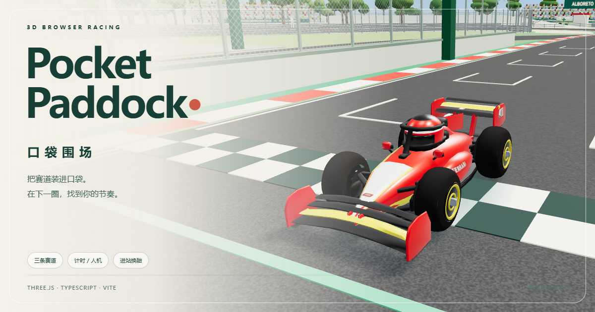

# Pocket Paddock · 作业项目说明

## 表单填写内容

### Title

Pocket Paddock · 口袋围场

### Short description

基于 Three.js 与 TypeScript 的 Q 版 3D 网页赛车游戏，支持三条赛道、计时挑战、人机竞速与进站换胎。

### Long description

Pocket Paddock（口袋围场）是一款以方程式赛车为主题的 3D 网页游戏，尝试将真实赛车场的辨识度、玩具沙盘的视觉风格与容易上手的驾驶体验结合起来。项目在 AI 工具辅助下逐步开发，通过持续试玩和反馈完善玩法、模型与界面。

当前版本包含蒙扎、斯帕和摩纳哥三条可驾驶赛道，提供自由计时和三圈人机竞速，支持十一支车队、二十二位车手，以及晴雨天气、中英文、键盘和标准映射手柄。玩家可使用 DRS，手动驶入维修区，再由辅助系统完成停车及 2–4 秒随机换胎。

项目使用 Three.js 构建场景与渲染，TypeScript 组织驾驶、赛车、赛道、摄像机、人机与界面模块，Vite 提供开发与生产构建。驾驶系统包含油门、制动、速度相关转向、抓地限制、路面减速与基础碰撞；圈速系统通过有顺序的检查点减少倒车或抄近路错误计圈，并在本地保存最佳成绩。

场景结合程序化几何体与 GLB 模型，补充车库、策略室、看台、围栏、树林和历史赛道等细节。开发过程中重点处理了坡道连续性、道路与地面的重叠、建筑穿插，以及不同设备上的绘制开销；采用实例化、静态合批和自适应画质控制场景成本。

本项目已形成可试玩原型，并保留源码和验证脚本。赛道布局、建筑与速度规则经过微缩化和游戏化调整。后续计划继续改善设备适配、人机驾驶表现，并扩展轮胎磨损、胎种性能与进站策略。

### 链接和状态

- GitHub repository：[leowang8431-lab/pocket-paddock](https://github.com/leowang8431-lab/pocket-paddock)
- Live site：[打开 Pocket Paddock](https://pocket-paddock-monza.leowang8431.chatgpt.site/)
- Status：选择含义为“开发中”或“可试玩原型”的选项；以表单实际选项为准。

英文简短介绍备选：

> A toy-style 3D browser racing game with three circuits, time trials, AI races, and assisted pit stops.

## 表单图片

| 表单栏位 | 对应文件 | 用途 |
| --- | --- | --- |
| Cover image | [cover.png](submission-assets/cover.png) | 1200 × 630 项目封面 |
| Desktop screenshot | [desktop.png](submission-assets/desktop.png) | 电脑端游戏界面 |
| Mobile | [mobile.png](submission-assets/mobile.png) | 移动端视口界面 |
| App icon | [app-icon.png](submission-assets/app-icon.png) | 180 × 180 图标 |
| Favicon | [favicon.png](submission-assets/favicon.png) | 32 × 32 标签图标 |
| 额外展示 | [gameplay.png](submission-assets/gameplay.png) | 驾驶画面，可用于项目介绍或报告 |

这些图片展示项目实际画面和现有图标；移动端视口截图不代替真实手机性能测试。

## 课堂演示建议

1. 打开在线试玩或在源码目录运行 `npm ci`、`npm run dev`。
2. 展示选车、换赛道、晴雨及中英文设置，再进入赛道驾驶。
3. 演示弯前制动、计时与检查点，介绍人机竞速和进站换胎。
4. 在 VS Code 中展示 `src/main.ts`、`src/track.ts`、`src/physics.ts`、`src/race.ts` 的模块分工。
5. 使用 [版本更新日志](../CHANGELOG.md) 说明从原型到当前版本的反馈与修正过程。

## 开发与资源说明

项目采用 AI 工具辅助开发，不将代码或素材表述为完全独立原创。赛车、头盔等部分资产由用户提供，场景大量使用程序化几何；录音、依赖与公开参考的说明见 [THIRD_PARTY_NOTICES.txt](../THIRD_PARTY_NOTICES.txt) 和 [README](../README.md)。参考真实赛道的布局与地标经过微缩和艺术化调整，不是测绘级复刻。
